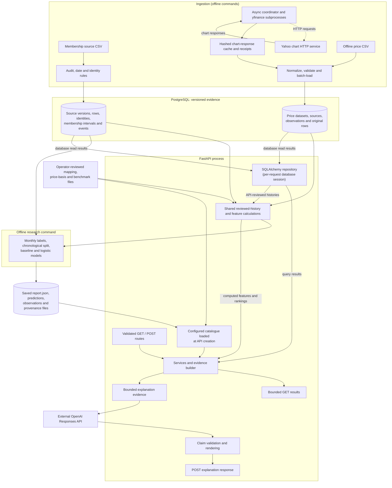

# Architecture overview

IndexLens separates historical source evidence, numerical research, and public explanation requests. Its purpose is to study recorded S&P 500 membership changes and describe reviewed market data; its removal results are exploratory retrospective research. This guide explains the component boundaries and engineering choices. The [README](../README.md) introduces the workflows and shows their high-level data flow.

Two workflows share the application components and use distinct evidence:

- **Synthetic integration sample:** invented 2025–2026 membership, prices, labels and a saved three-feature research run exercise the local PostgreSQL/API workflow.
- **Historical research:** reviewed membership source records and Yahoo-returned stock/benchmark prices support an exploratory chronological removal study, including an expanded fitted feature set. The API can publish selected saved research reports without retraining the models.

## 1. Components and boundaries

Solid arrows show the movement of source evidence and calculated results. The dashed arrow shows the HTTP requests made to Yahoo; function-call order within the API is detailed in the request traces below.



PostgreSQL stores ingested membership and price evidence. Review declarations and research outputs are **separate files**. The API loads configured reviews, benchmark reviews and reports into a catalogue when the app is created (`indexlens.api.service.Catalog`); incoming identifiers select those approved entries. Model fitting occurs in the research command. Database-backed GET endpoints calculate features and rankings from stored evidence; saved research endpoints serve configured reports.

## 2. Data ingestion and source identity

The membership path starts in [`data_audit.py`](../src/indexlens/data_audit.py) and [`membership.py`](../src/indexlens/membership.py). `load_source_csv` in [`db/loading.py`](../src/indexlens/db/loading.py) audits one pinned CSV, prepares membership intervals and recorded ADD/REMOVE events, and stores the original bytes, hashes, source positions, audit fields and date flags. A source identity records a symbol/CIK pair **within one source version**; historical continuity across versions requires separate evidence. Membership snapshots interpret recorded events using the `created_at` guard and approximate-date warnings.

The price path accepts an offline CSV or a Yahoo request manifest. [`prices/ingestion.py`](../src/indexlens/prices/ingestion.py) coordinates a queue of asynchronous workers; each Yahoo download runs in a separate [`yahoo_worker.py`](../src/indexlens/prices/yahoo_worker.py) process. A shared SQLite pacing gate spaces underlying HTTP calls even with multiple workers. Timeouts, bounded transient retries and cached response/receipt hashes make failures inspectable and reruns reusable. Yahoo chart response bytes are the canonical input for conversion; yfinance's exported table is comparison evidence.

Yahoo chart responses are converted to logical CSV rows; [`prices/loading.py`](../src/indexlens/prices/loading.py) applies the same normalization and storage rules to those rows and offline CSV input. It preserves original records and metadata, validates prices, OHLC relationships and volume, and records invalid dates, duplicates and conflicts. An observation is keyed by dataset, provider, symbol, date and price basis. Equal repeats share an observation; contradictory values remain visible and block its use. Price reviews separately approve dated historical identity mapping and price basis; analysis requires these approvals in addition to successful ingestion.

**Concurrency and cancellation:** `asyncio` coordinates multiple download workers concurrently, while a separate process isolates each `yfinance` download job so it can be terminated on a job timeout. Database loads run in threads through `asyncio.to_thread`, each with its own SQLAlchemy session. `asyncio.shield` protects an active load from cancellation; explicit cleanup waits for the load to commit or roll back before the coordinator finishes. Concurrency and shared HTTP request pacing are controlled separately. The added process and cache state support bounded failures, cancellation and reuse. See [price ingestion and failure handling](prices.md#resume-request-controls-and-failure-handling).

## 3. PostgreSQL and transactions

[`db/models.py`](../src/indexlens/db/models.py) declares SQLAlchemy tables for membership versions, identities, source rows, intervals, events and issues, and for price datasets, sources, observations and rows. [Alembic migrations](../migrations/versions) build the schema; database uniqueness, keys and relationships protect repeat loads and source links.

The membership and price loaders each own one transaction. On failure, the entire source load rolls back; duplicate versions/sources can be reused safely. Price loads serialize within a dataset namespace to protect cross-file observation conflicts. The price loader batches row conversion while retaining source bytes and decoded CSV content in memory; memory usage therefore grows with input size.

Read semantics are different from load semantics. `create_app.access` in [`api/app.py`](../src/indexlens/api/app.py) creates a new `REPEATABLE READ`, PostgreSQL read-only transaction and SQLAlchemy `Session` for a database-backed API operation, with a local 15-second statement timeout. Its context manager closes the session and transaction when the database operation finishes. This provides a consistent view across related queries and avoids sharing mutable sessions between requests.

## 4. Reviewed numerical analysis

[`features/query.py`](../src/indexlens/features/query.py) checks the selected dataset and membership source version, then retrieves dated price observations and records blockers for unreviewed price sources, identity mappings, price bases and dates. [`features/core.py`](../src/indexlens/features/core.py) calculates three descriptive observed-session features: 20-session return (21 closes), sample volatility of 20 daily returns (21 closes) and average share volume (20 observations). It selects the required window **before** checking values. Invalid, conflicted and unapproved observations remain blockers within the selected window. Missing or unusable values produce `null` features with explicit reasons. Entirely absent sessions remain a coverage limitation.

The momentum ranking orders eligible identities by descending 20-session return with a deterministic symbol/CIK tie-breaker. It requires a common reference observation date; optional membership context applies the date-guarded source snapshot. The ranking describes historical performance; removal likelihood is evaluated separately by the research model.

[`features/context.py`](../src/indexlens/features/context.py) and [`context_review.py`](../src/indexlens/features/context_review.py) add stock/benchmark returns, excess returns, volatility, drawdown and dollar-activity context from longer reviewed windows. The financial-context response exposes sixteen descriptive indicators; the current expanded removal model fits **nine selected predictors**. The three-feature comparator uses average share volume; the expanded model uses dollar-volume predictors. Benchmark comparisons require matching observation dates. Feature calculations use `Decimal` arithmetic; the model converts eligible predictors to NumPy floating-point arrays for scikit-learn. Pandas supports source tables and monthly research cohorts. See [feature roles and formulas](features.md#feature-roles).

## 5. Removal study and saved reports

[`research/workflow.py`](../src/indexlens/research/workflow.py) builds calendar-month-end membership snapshots and joins their labels to approved, date-bounded features. [`research/labels.py`](../src/indexlens/research/labels.py) assigns a positive label only when a **recorded REMOVE** event matches an active source record within the following 30 calendar days. Incomplete outcome coverage, ambiguous or approximate dates and duplicated active identities produce explicit exclusions. For research month-ends that are not trading days, the feature date is the last scheduled NYSE session on or before the reference date; missing data on that session makes the feature unavailable.

[`research/model.py`](../src/indexlens/research/model.py) compares a constant probability equal to the training positive rate with scaled logistic regression. The original specification has three short-window predictors; the expanded specification uses nine stock/benchmark-derived predictors and compares them on the **same eligible rows** with the matched three-feature model. The historical split uses January 2022–November 2024 training reference dates (with training outcomes ending by 31 December 2024) and January 2025–July 2026 test references. Standardisation is fitted on training data only, avoiding test-distribution leakage into scaling. Reported precision, recall, F1, average precision, Brier score and confusion matrices expose both ranking and decision-cutoff behaviour, with undefined results stated explicitly.

The CLI in [`research/__main__.py`](../src/indexlens/research/__main__.py) fits from stored inputs under a read-only database snapshot, then saves a versioned `report.json`, `observations.jsonl.gz`, configuration/input hashes, reviewed evidence references, package versions and code state under a new `data/` output directory. In [`api/service.py`](../src/indexlens/api/service.py), `SavedResearch` serves the recorded probabilities and metrics to API clients. This keeps response cost low and explanations tied to a fixed analysis; changes to evidence or model choices require regenerating and republishing the report.

These comparisons remain **exploratory**. The historical test period was inspected during feature/cutoff development, and histories of the same securities and events are dependent. Independent predictive validation requires evaluation on an uninspected future period. See [research design, metrics and limitations](research.md).

## 6. API layers and a read-only request trace

[`api/app.py`](../src/indexlens/api/app.py) registers FastAPI routes, applies the request/response contracts and manages database sessions. Data API models are defined in [`api/schemas.py`](../src/indexlens/api/schemas.py), and explanation request/response models in [`api/explanation.py`](../src/indexlens/api/explanation.py). [`api/service.py`](../src/indexlens/api/service.py) applies identifier, coverage, provenance, pagination and publication rules. [`api/repository.py`](../src/indexlens/api/repository.py) makes SQLAlchemy queries and invokes the shared feature/history logic. Source-version-specific security identifiers have the form `v<version_id>-s<identity_position>`; clients discover them with `GET /api/v1/indices/{index_id}/securities` rather than treating tickers as permanent keys. The service binds those IDs to configured versions and reviewed provider mappings.

For example, a feature request follows this trace:

```text
GET /api/v1/securities/{security_id}/features
    ?review_id={review_id}&reference_date=YYYY-MM-DD
  → FastAPI validates security ID, review ID and ISO date
  → create_app.access(): open READ ONLY, REPEATABLE READ transaction
  → Service.features() → Service.mapped(): validate source version and review
  → Repository.history() → features.query.reviewed_history()
  → Query stored price observations; mark unapproved/conflicting inputs
  → features.core.calculate(): compute complete windows or unavailable reasons
  → Service.features(): attach inputs, review hash, data kind and coverage
  → bounded() response → transaction/session close → JSON
```

The database is read only while this request gathers its evidence. The service returns feature values as strings (preserving decimal precision), or `null` with named reasons, plus observed dates and source metadata. The API distinguishes an unknown security/review from a valid but unusable price window. Saved run summaries (`GET /api/v1/research/runs/{run_id}`) come from the configured catalogue; they do not require a database query. See [API contracts and error responses](api.md).

## 7. Explanation lifecycle and the external boundary

`POST /api/v1/research/explain` accepts a bounded, validated target: recorded event, ranking, saved run or company financial context. It supports only the documented questions. [`api/explanation.py`](../src/indexlens/api/explanation.py) constructs a restricted evidence object from the relevant service operation and/or saved run; matching a company prediction also checks identity, source/review hashes, reference date, fitted values and input fingerprints. It labels synthetic versus real evidence and appends interpretation boundaries.

```text
POST /api/v1/research/explain
  → Pydantic target validation + check_question()
  → run_in_threadpool(explanation_evidence, payload)
       → saved run: read configured catalogue
       → event / ranking / company: create_app.access() read transaction
       → build_evidence() selects, checks and bounds supporting facts
       → close database transaction (when one was used)
  → await openai_provider.explain() via AsyncOpenAI Responses API
       → send evidence and exact scalar-claim catalogue (no provider tools)
       → parse bounded structured Draft with deadline/retry handling
  → validate_draft(): check data kind, JSON Pointers, scalar values,
       citation placeholders and required comparison claims
  → presentation rendering + evidence hash, limitations and generation metadata
  → bounded() JSON response
```

**Resource boundary:** `explanation_evidence` closes any database transaction before the application awaits OpenAI. Saved-run explanations obtain their evidence directly from the in-memory catalogue.

[`api/openai_provider.py`](../src/indexlens/api/openai_provider.py) uses a configured Responses model, bounded input/output, timeout and retry rules, `store=False` and no tools. [`api/explanation.py`](../src/indexlens/api/explanation.py) verifies each cited scalar's exact JSON Pointer and canonical value; [`api/presentation.py`](../src/indexlens/api/presentation.py) deterministically renders checked values and citation markers. These checks detect invented numerical references and uncited numeric prose; source accuracy, causal interpretation and qualitative correctness remain outside their guarantees. Missing credentials return `503 openai_not_configured`; malformed, refused and failed provider outputs have explicit errors. See [explanations and security boundaries](explanations.md).

## 8. Engineering decisions, checks and limits

The principal trade-offs are grouped here by **engineering challenge → design choice → trade-off → verification**.

| Engineering challenge | Design choice | Trade-off | Evidence of verification |
|---|---|---|---|
| Ambiguous historical identities and dates | Versioned, source-positioned PostgreSQL rows and guarded membership queries | Source ambiguity stays visible; a symbol/CIK pair still needs historical interpretation | [Database equivalence, repeat loads and rollback](database.md#checks) |
| Concurrent requests and provider rate limits | Async worker queue, subprocess isolation, shared pacing, hashed cache and bounded retries | More cache/process state; provider failures and incomplete histories remain possible | [Offline/real-provider checks and cancellation rules](prices.md#provider-evidence-and-verification) |
| Incomplete and unapproved price evidence | Reviewed mapping/basis and complete observed-session windows | Historical coverage gaps leave features unavailable until approved evidence supplies the required dates | [Window definitions and rejected inputs](features.md#formulas-and-unavailable-values) |
| Model evaluation bias and reproducibility | Chronological cohort, training-only scaling, prevalence baseline, saved report | Retrospective metrics are exploratory; new data requires a new fit | [Research checks and limitations](research.md#limitations-and-further-work) |
| API responsibility boundaries and database connection lifetime | Validated routes → services → repositories; request-scoped read-only transactions | Extra layers and bounded response shapes | [API tests and response/error contracts](api.md#limits-and-errors) |
| Unsupported AI claims and numerical inaccuracies | Application-selected evidence, schema plus exact-value claims, deterministic citations | Qualitative interpretation still needs review; external provider may fail | [Explanation verification and failures](explanations.md#verification) |
| Environment drift and live-provider dependencies | Alembic, Compose sample, Ruff/mypy/pytest and GitHub Actions jobs; mocked provider tests | External coverage, credentials and remote CI must be assessed separately | [Delivery checks](delivery.md#checks-and-logs) and [measured comparisons](performance.md) |

The synthetic Docker sample checks the connected local workflow; the historical fit is documented through separate saved research evidence. Public saved [model-comparison and company explanations](examples/removal-research/README.md) can be verified offline, while live OpenAI access is a separate check. Remote GitHub Actions results require separate verification from local test and Docker runs. The recorded performance experiments measure identity lookup, batching/materialisation and database insert overhead under test conditions; production throughput requires separate measurement.

Historical caveats cross all layers: membership records derive from Wikipedia rather than an official S&P DJI event feed; Yahoo series and historical mappings may be incomplete or adjusted; point-in-time source availability remains unverified; and predicted removal probabilities are model estimates rather than observed removals or causal explanations. Reviews, exclusions, saved reports and API explanation evidence retain these limitations.

For operational commands and the reproducible sample, see [delivery](delivery.md); for provider controls, [prices](prices.md); for numerical definitions, [features](features.md); for experiment construction, [research](research.md); and for evidence presentation, [explanations](explanations.md).
